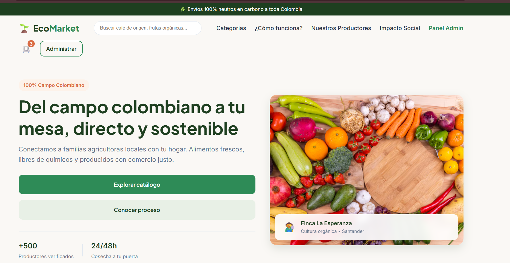
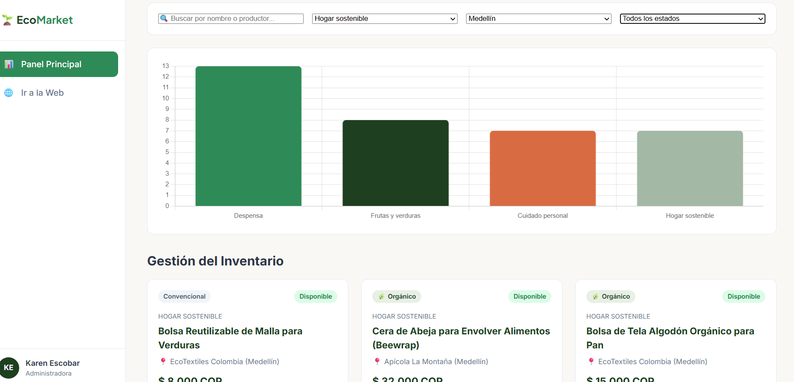
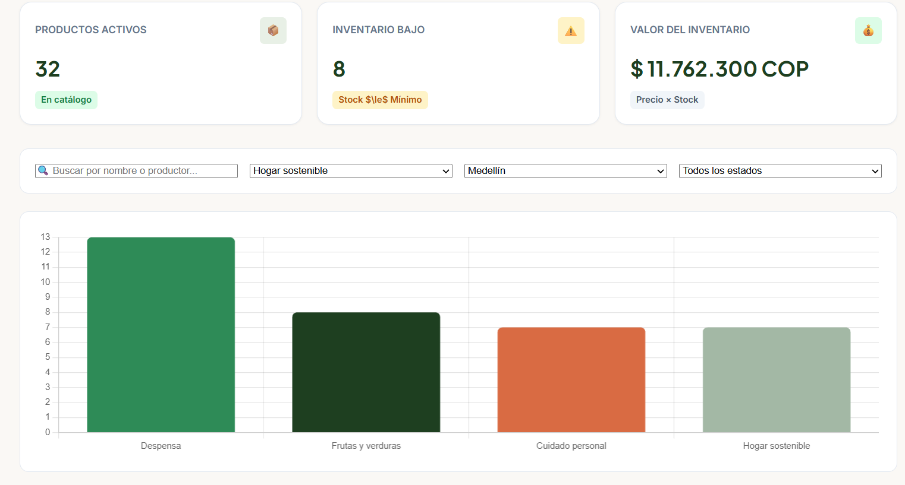
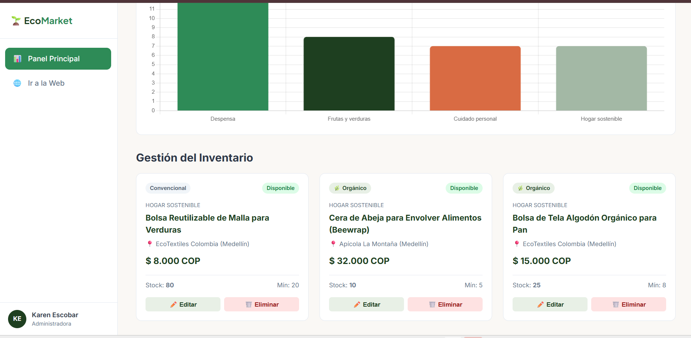
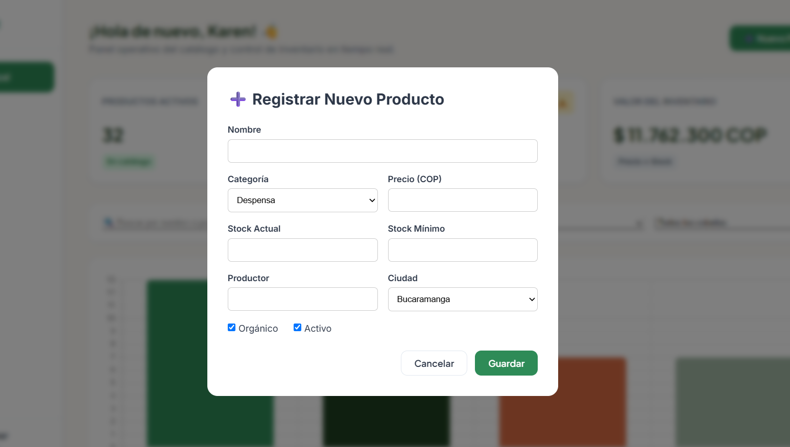
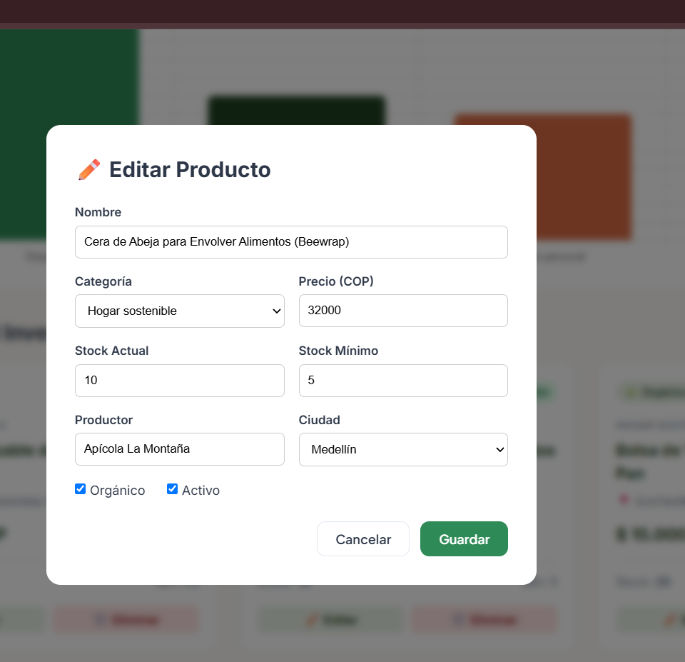

# 🌿 EcoMarket — Plataforma Web para Comercio Sostenible con IA

**Taller Práctico 2: Desarrollo Web con IA**  
**Startup:** EcoMarket (Colombia)  
**Desarrolladora:** Karen Yaritza Escobar Pinto

## 📌 Descripción del Proyecto

EcoMarket es una plataforma web desarrollada para conectar a pequeños productores locales de alimentos orgánicos y artículos sostenibles con consumidores que buscan realizar compras responsables. El proyecto consta de una **Landing Page** comercial y un **Panel Administrativo (Dashboard)** con gestión de inventario en tiempo real, operaciones CRUD, filtros combinados, persistencia de datos mediante `localStorage` y visualización estadística con Chart.js.

## 🛠️ Tecnologías y Estándares Utilizados

- **HTML5 Semántico:** Estructura limpia con etiquetas accesibles (`header`, `nav`, `main`, `section`, `footer`, `aside`) y atributo `lang="es"`.
- **CSS3 Avanzado:** Diseño responsivo *Mobile-First*, variables en `:root`, Flexbox, CSS Grid y diseño de componentes modulares.
- **JavaScript Vanilla (ES6+):** Manipulación del DOM, asincronía (`async/await` con `fetch`), validaciones programáticas y manejo de estado.
- **Librerías Externas:** Chart.js para el gráfico estadístico dinámico de categorías.
- **Persistencia:** Almacenamiento local del navegador (`localStorage`).

## 📂 Estructura de Archivos del Repositorio

```text
/
├── index.html        # Landing page de presentación comercial
├── dashboard.html    # Panel administrativo de inventario y KPIs
├── styles.css        # Estilos generales y diseño visual de la landing
├── dashboard.css     # Estilos específicos del panel de administración
├── productos.json    # Dataset inicial con 35 registros (5 manuales + 30 generados con IA)
├── app.js            # Lógica principal, motor CRUD, filtros y Chart.js
├── dashboard.js      # Control de interactividad y menú hamburguesa responsive
└── validacion.js     # Script de validación programática de reglas de negocio
```

## 🤖 Prompt Engineering y Metodología de Desarrollo con IA

Durante el desarrollo del prototipo se aplicaron diferentes técnicas de ingeniería de prompts para guiar al asistente de inteligencia artificial de manera estructurada:

### Priming (Preparación de Contexto)

- **Propósito:** Definir el rol experto de la IA antes de generar código.
- **Prompt base:** "Actúa como un desarrollador frontend senior especializado en comercio electrónico y UX/UI. Vas a participar en el desarrollo de EcoMarket..."

### Chain of Thought (Razonamiento en Cadena)

- **Propósito:** Solicitar un análisis previo de diseño (jerarquía visual, paleta de colores verde natural, accesibilidad WCAG) antes de escribir código HTML/CSS.

### Few-Shot Prompting (Generación de Datos)

- **Propósito:** Proveer 5 registros manuales como ejemplo estricto para que la IA generara los 30 objetos restantes asegurando la coherencia exacta con el esquema JSON (`id`, `nombre`, `categoria`, `precio`, `stock`, `stockMinimo`, `productor`, `ciudad`, `organico`, `fechaRegistro`, `activo`).

## 📋 Informe de Hallazgos y Validación Programática (Fase 4)

Se implementó el script de auditoría `validacion.js` para revisar la integridad de los datos antes de cargarlos en la interfaz. A continuación se presenta el reporte de validación sobre pruebas de control:

| ID / Registro | Campo afectado | Descripción del problema / causa | Corrección aplicada |
|---|---|---|---|
| -5 | `id` | El ID debe ser un número entero estrictamente mayor a 0. | Se corrigió por un ID positivo único consecutivo. |
| -5 | `categoria` | La categoría 'Dulces' no pertenece a las permitidas. | Se reasignó a una categoría válida ("Despensa"). |
| -5 | `precio` | El precio recibido (-1000) no es un número positivo. | Se ajustó a un valor numérico entero en COP ($ > 0$). |
| -5 | `productor` | El campo productor se encontraba vacío. | Se especificó el nombre comercial del productor local. |
| -5 | `ciudad` | La ciudad 'Madrid' no está dentro del mercado objetivo. | Se actualizó a una ciudad permitida ("Bucaramanga"). |
| -5 | `organico` | El campo orgánico recibió un string ("si") en lugar de booleano. | Se corrigió al tipo de dato estricto true / false. |
| -5 | `fechaRegistro` | Formato de fecha inválido ("15/01/2026"). | Se estandarizó al formato ISO YYYY-MM-DD. |

## 🚀 Instrucciones de Ejecución Local

Dado que la aplicación consume el archivo de datos mediante `fetch()`, se requiere un servidor local:

1. Clona este repositorio o descarga los archivos en tu equipo.
2. Abre la carpeta del proyecto en Visual Studio Code.
3. Instala y abre la extensión Live Server.
4. Haz clic derecho sobre `index.html` y selecciona "Open with Live Server" (o haz clic en el botón Go Live en la barra inferior de VS Code).
5. Para acceder al panel de administración, navega directamente a `dashboard.html` o utiliza el enlace directo en la barra de navegación superior.

## 🧠 Preguntas de Reflexión

1. **¿Qué diferencias encontraste entre utilizar zero-shot, one-shot y few-shot prompting?**
   * El zero-shot da instrucciones generales sin ejemplos previos. El few-shot*(utilizado para el JSON) provee ejemplos estructurados estrictos, garantizando que la IA replique con precisión exacta los tipos de datos, nombres de campos y restricciones de negocio.

2. **¿Por qué es importante definir la estructura y las reglas del dataset antes de generarlo con IA?**
   * Previene inconsistencias de tipos de datos, asegura que las categorías y ciudades coincidan con los filtros de la aplicación y evita que falle la validación programática.

3. **¿Qué errores detectó la validación programática que no habías identificado manualmente?**
   * Detectó sutiles desajustes de tipos de datos (como booleanos recibidos como texto o fechas fuera del rango cronológico establecido), asegurando que el motor visual no colapse.

4. **¿Qué ventajas ofrece separar los datos, la lógica JavaScript y la presentación HTML/CSS?**
   * Mantiene la modularidad y el principio de responsabilidad única. Permite escalar la interfaz visual sin alterar las reglas de negocio y consumir catálogos locales de forma independiente.

5. **¿Qué limitaciones tiene localStorage frente a una base de datos real?**
   * El localStorage tiene una capacidad de almacenamiento muy limitada (aprox. 5MB), carece de transacciones complejas, seguridad de acceso, consultas relacionales avanzadas y no permite sincronización multiusuario en tiempo real.

6. **¿Qué cambios realizarías para convertir el prototipo en una aplicación lista para producción?**
   * Implementar un backend con una base de datos real (ej. PostgreSQL o MongoDB), autenticación segura de usuarios (JWT), validación de esquemas en servidor y empaquetado con un framework moderno.

---

## 📸 Evidencias y Capturas de Pantalla del Sistema

### 🌐 1. Página Principal (Landing Page)


### 📊 2. Panel Principal (Dashboard y KPIs)


### 📈 3. Gráfico Estadístico Dinámico (Chart.js)


### 🔍 4. Filtros Combinados en Tiempo Real


### ➕ 5. Formulario de Registro (Crear Producto)


### ✏️ 6. Formulario Modal (Editar Producto)
